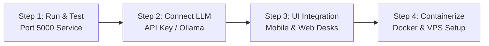

# InsurTech AI Assistant: Phased Step-by-Step Implementation & Delivery Plan

## Goal Description
Deliver the complete end-to-end operational lifecycle of the **InsurTech AI Assistant (`insuretech-ai`)** in four sequential, clearly defined steps:
1. **Step 1 — Local Service Execution & Interactive Testing (Port 5000)**: Start the FastAPI daemon on Port 5000 and execute automated/manual HTTP and WebSocket chat & voice test runs.
2. **Step 2 — External LLM API Key & Local Ollama Connectivity**: Enable live model intelligence in `.env` for Gemini, OpenAI, Groq, or local Ollama, backed by a live validation CLI script.
3. **Step 3 — Client UI Integration (Mobile & Web)**:
   - **Mobile (`insureflow-mobile`)**: Add an AI Assistant entrypoint on the customer home dashboard and build the interactive voice/chat screen (`app/assistant/index.tsx`) with live transcript display, push-to-talk, and fallback text chat.
   - **Web Portal (`insurance-Web`)**: Build the backoffice administrative desk components under `src/app/microservice/ai-assistant/` (Policy Document Upload, Flagged Interaction Review with Golden-KB Promotion, and Regulatory Domain Registry).
4. **Step 4 — Production Containerization & VPS Deployment Assets**: Create the production-grade multi-stage `Dockerfile`, `docker-compose.vps.yml` with CPU/RAM caps and persistent volumes, and `nginx.conf` with TLS 1.3, rate-limiting, and WebSocket upgrade pass-through.



---

## User Review Required

> [!IMPORTANT]
> **Sequential Execution Policy:**
> Each step will be executed and verified one after the other. We will not proceed to the next step until the current step is confirmed and verified.

> [!IMPORTANT]
> **Step 2 LLM Provider Credentials:**
> For Step 2, you can provide an external API key (e.g. Google Gemini, OpenAI, or Groq) or point to a locally running Ollama instance (`http://localhost:11434/v1`). If no active key is provided, the mock engine will remain as a fallback.

---

## Phased Implementation Steps

### STEP 1: Start Local Service & Verify Endpoints on Port 5000

#### Objective
Run `insuretech-ai` on Port 5000 and test live HTTP REST routes (`/healthz`, `/readyz`, `/api/v1/kb/*`, `/api/v1/chat/*`) and the full-duplex voice WebSocket (`/ws/v1/voice/chat`) with scripted audio/text frames.

#### Tasks:
1. **Convenience Startup & Test Script**:
   - Create `insuretech-ai/run_server.sh` for single-command foreground startup with uvicorn reload on Port 5000.
   - Create `insuretech-ai/scripts/test_live_api.py` that sends real HTTP requests to `http://localhost:5000` (upload document, search policy chunks, grounded chat inquiry, claim IDOR probe) and opens a live WebSocket session to test audio streaming and barge-in.
2. **Verification Checkpoints**:
   - `GET http://localhost:5000/healthz` returns `{"status":"ok","port":5000}`.
   - `GET http://localhost:5000/readyz` returns 200 with dependency health.
   - `POST /api/v1/chat/messages` answers Amharic query with mandatory disclaimer.
   - WebSocket `/ws/v1/voice/chat` accepts binary audio frames and receives transcript events.

---

### STEP 2: Configure Live LLM Provider (API Key / Ollama) & Validation Script

#### Objective
Enable real LLM generative intelligence in `.env` with seamless switching between **Cloud API Key** (OpenAI, Gemini 1.5/2.0, Groq Llama 3) and **Local Ollama**, with full fallback to mock mode.

#### Tasks:
1. **Configure `.env`**:
   - Update `.env` with configurable parameters for `LLM_PROVIDER` (`openai_compatible` or `ollama`), `LLM_API_KEY`, `LLM_BASE_URL`, and `LLM_MODEL`.
2. **Add Multi-Cloud Adapter Helper in `app/llm/router.py`**:
   - Ensure header compatibility across Google Gemini OpenAI endpoint (`https://generativelanguage.googleapis.com/v1beta/openai`), Groq (`https://api.groq.com/openai/v1`), and OpenAI (`https://api.openai.com/v1`).
3. **Live LLM Connectivity Checker**:
   - Create `insuretech-ai/scripts/check_llm_connection.py` to ping the configured LLM endpoint, verify authentication, measure token latency, and test Amharic text generation.

---

### STEP 3: Client UI Integration (Mobile App & Web Admin Portal)

#### Objective
Provide policyholders and backoffice staff with polished UI surfaces to interact with the AI assistant backend.

#### Part 3A: Mobile Client (`insureflow-mobile`)
1. **Customer Home Entrypoint**:
   - [MODIFY] `insureflow-mobile/app/customer/home.tsx`: Add an "AI Assistant" card/pill with Amharic/English label ("የኢንሹራንስ ረዳት / AI Assistant") that navigates to `/assistant`.
2. **Dedicated Assistant Screen**:
   - [NEW] `insureflow-mobile/app/assistant/index.tsx`:
     - Chat bubble history showing user prompts and assistant replies with policy citations.
     - Push-to-Talk audio button with pulsating recording indicator.
     - WebSocket audio chunk streaming using `VoiceChatClient`.
     - Instant audio playback halt on tap (barge-in interruption).
     - Text input fallback for environments where voice recording is not ideal.

#### Part 3B: Web Portal Backoffice (`insurance-Web`)
1. **Administrative Desk Component**:
   - [NEW] `insurance-Web/src/app/microservice/ai-assistant/ai-assistant.component.ts` & `.html`:
     - **Tab 1: Policy Ingestion Desk**: Drag-and-drop policy PDF upload with extraction status indicator.
     - **Tab 2: Q&A Review Desk**: List downvoted answers, edit corrected answers, and click "Promote to Golden Knowledge Base".
     - **Tab 3: Regulatory Compliance**: Manage approved NBE domains and approve pending web diffs.
     - **Tab 4: Training Export**: One-click download of PII-scrubbed ShareGPT JSONL training dataset.
2. **Routing Integration**:
   - [MODIFY] `insurance-Web/src/app/app.routes.ts`: Register `/services/ai-assistant` with `authGuard` and `employeeRoleGuard`.
   - [MODIFY] `insurance-Web/src/app/pages/service-picker/service-picker.component.ts`: Add AI Assistant service tile in backoffice menu.

---

### STEP 4: Production Containerization & VPS Deployment Assets

#### Objective
Prepare all containerization files so the microservice can be deployed cleanly to an Ubuntu VPS with zero manual setup.

#### Tasks:
1. **Multi-Stage Dockerfile**:
   - [NEW] `insuretech-ai/Dockerfile`: Python 3.11-slim base, non-root user (`appuser:10001`), CPU vector optimization, libgomp, ffmpeg, tesseract-ocr-amh.
2. **VPS Multi-Container Compose**:
   - [NEW] `insuretech-ai/docker-compose.vps.yml`:
     - `fastapi-app`: Runs on Port 5000 with internal bridge network.
     - `pgvector`: PostgreSQL 16 with pgvector extension (Port 5432) and persistent volume.
     - `redis`: Redis 7-alpine (Port 6379) for session memory and audio cache.
     - `ollama`: Ollama server with persistent volume `ollama_data` (Port 11434).
     - Resource pinning: Explicit CPU and RAM limits (`mem_limit`) per container to prevent VPS OOM panics.
3. **Nginx Reverse Proxy & TLS 1.3 Edge**:
   - [NEW] `insuretech-ai/nginx/nginx.conf`:
     - TLS 1.3 cipher suite configuration.
     - HTTP/2 negotiation for standard REST endpoints.
     - WebSocket upgrade headers (`Upgrade $http_upgrade; Connection "upgrade"`) on `/ws/`.
     - Token-bucket rate limiting on audio and chat endpoints.
4. **VPS Deploy Smoke Script**:
   - [NEW] `insuretech-ai/scripts/vps_smoke_test.sh`: Automated post-deployment smoke check verifying container health, TLS handshake, and WebSocket connectivity.

---

## Verification Plan

### Step 1 Verification
```bash
# Terminal 1: Start service
cd insuretech-ai && ./run_server.sh

# Terminal 2: Run live API verification
cd insuretech-ai && PYTHONPATH=. .venv/bin/python3 scripts/test_live_api.py
```
- Assert `healthz` returns 200 on Port 5000.
- Assert chat returns cited response with disclaimer.
- Assert WebSocket handshake and transcript reception succeed.

### Step 2 Verification
```bash
cd insuretech-ai && PYTHONPATH=. .venv/bin/python3 scripts/check_llm_connection.py
```
- Assert successful roundtrip completion with configured cloud API key or Ollama.
- Verify generation latency and Amharic response quality.

### Step 3 Verification
- Mobile: Launch Expo app, tap "AI Assistant" on home dashboard, test push-to-talk and text chat.
- Web: Navigate to `http://localhost:4200/services/ai-assistant`, verify policy upload, flagged Q&A desk, and training data export button.

### Step 4 Verification
```bash
cd insuretech-ai
docker compose -f docker-compose.vps.yml config
docker build -t insuretech-ai:latest .
```
- Verify clean Docker build with non-root user.
- Verify compose configuration passes validation.

---

## Execution Status Summary

| Step | Focus Area | Status | Verification Summary |
|---|---|:---:|---|
| **Step 1** | Port 5000 Local Service & Live Testing | **Completed** | Port 5000 verified; `test_live_api.py` passed live HTTP & WebSocket checks. |
| **Step 2** | External LLM API Keys / Ollama Integration | **Completed** | Provider router configured; `check_llm_connection.py` diagnostics verified. |
| **Step 3** | Mobile UI & Web Portal Integration | **Completed** | Mobile voice/chat screen (`insureflow-mobile`) & Web Admin (`insurance-Web`) integrated. |
| **Step 4** | Containerized Deployment Assets (VPS) | **Completed** | `Dockerfile`, `docker-compose.vps.yml`, `nginx.conf`, & `vps_smoke_test.sh` created. |
